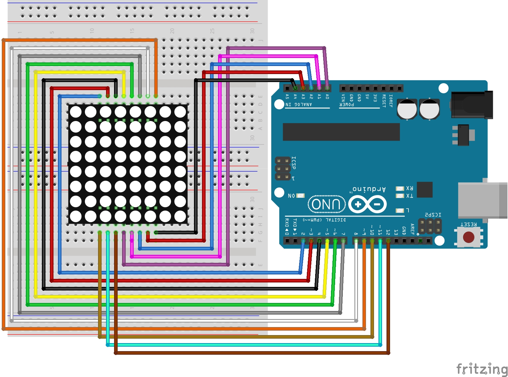

# Lekcja 15: Matryca LED 8x8

Ćwiczenie wykonane podczas pracowni zawodowej. W tej lekcji podłączyłem do Arduino UNO matrycę LED **1088BS 8x8** i napisałem program wyświetlający na niej serce.

Matryca została podłączona bez dodatkowego sterownika, dlatego za jej odświeżanie odpowiada bezpośrednio Arduino.

### Czego się nauczyłem:
* Dowiedziałem się, jak zbudowana jest matryca LED 8x8.
* Poznałem zasadę **multipleksowania**.
* Nauczyłem się zapisywać prosty obraz w postaci dwuwymiarowej tablicy zer i jedynek.
* Przećwiczyłem używanie tablic zawierających numery pinów.
* Wykorzystałem zagnieżdżone pętle `for` do przechodzenia przez wszystkie piksele matrycy.
* Napisałem funkcję `wyswietlSerce()`, która odpowiada za odświeżanie obrazu.

### Czym jest matryca LED 8x8?

Matryca LED 8x8 składa się z **64 diod LED** ułożonych w 8 wierszach i 8 kolumnach. Każda dioda znajduje się na przecięciu konkretnego wiersza i konkretnej kolumny.

Zamiast wyprowadzać osobne przewody do każdej diody, matryca wykorzystuje wspólne linie wierszy i kolumn. Dzięki temu całość ma tylko **16 wyprowadzeń: 8 wierszy i 8 kolumn**.

W projekcie wykorzystałem matrycę **1088BS**.

### Jak działa multipleksowanie?

Arduino bardzo szybko przechodzi po kolejnych punktach matrycy i zapala tylko te diody, które należą do wyświetlanego obrazu.

Pojedyncza dioda świeci przez bardzo krótki czas, a następnie program przechodzi do następnej. Cały proces powtarza się tak szybko, że ludzkie oko nie widzi pojedynczych błysków i odbiera je jako jeden ciągły obraz.

W tym programie w danej chwili zapalana jest tylko jedna dioda.

### Jak zapisany jest obraz serca?

Obraz został zapisany w dwuwymiarowej tablicy `serce[8][8]`.

* `1` oznacza, że dioda ma świecić,
* `0` oznacza, że dioda ma być zgaszona.

```C++
const byte serce[8][8] = {
  {0, 1, 1, 0, 0, 1, 1, 0},
  {1, 1, 1, 1, 1, 1, 1, 1},
  {1, 1, 1, 1, 1, 1, 1, 1},
  {1, 1, 1, 1, 1, 1, 1, 1},
  {0, 1, 1, 1, 1, 1, 1, 0},
  {0, 0, 1, 1, 1, 1, 0, 0},
  {0, 0, 0, 1, 1, 0, 0, 0},
  {0, 0, 0, 0, 0, 0, 0, 0}
};
```

Graficznie serce wygląda tak:

```text
.##..##.
########
########
########
.######.
..####..
...##...
........
```

### Tablice `rows[]` i `cols[]`

Numery pinów Arduino są zapisane w dwóch tablicach:

```C++
const byte rows[8] = {
  9, 4, A4, 6, 10, A3, 11, A1
};

const byte cols[8] = {
  5, 12, A0, 8, A2, 7, 3, 2
};
```

`rows[]` przechowuje piny odpowiadające wierszom, a `cols[]` piny odpowiadające kolumnom.

Dzięki temu mogę obsługiwać kolejne wyprowadzenia za pomocą pętli zamiast pisać osobną instrukcję dla każdego pinu.

### Zagnieżdżone pętle `for`

Do przechodzenia przez całą matrycę wykorzystałem dwie pętle `for`.

```C++
for (byte r = 0; r < 8; r++) {
  for (byte c = 0; c < 8; c++) {
    // obsługa serce[r][c]
  }
}
```

Pierwsza pętla przechodzi przez 8 wierszy, a druga przez 8 kolumn. Dzięki temu program może sprawdzić wszystkie **64 pola** matrycy.

### Funkcja `wyswietlSerce()`

Kod odpowiedzialny za obsługę matrycy został umieszczony w osobnej funkcji:

```C++
void wyswietlSerce() {
  // odświeżanie matrycy
}
```

Dzięki temu główna pętla programu jest bardzo prosta:

```C++
void loop() {
  wyswietlSerce();
}
```

### Funkcja `delayMicroseconds()`

Przy multipleksowaniu potrzebne są bardzo krótkie opóźnienia.

```C++
delayMicroseconds(150);
```

Funkcja `delayMicroseconds()` działa podobnie do `delay()`, ale czas podawany jest w **mikrosekundach**, a nie milisekundach.

W tym przypadku jedna dioda świeci przez 150 mikrosekund, czyli 0,00015 sekundy.

### Czy potrzebna jest biblioteka?

W tym projekcie **nie użyłem żadnej dodatkowej biblioteki**.

Matryca jest sterowana bezpośrednio za pomocą standardowych funkcji Arduino:

* `pinMode()`
* `digitalWrite()`
* `delayMicroseconds()`

W bardziej rozbudowanych projektach do sterowania matrycami LED można wykorzystać dodatkowy sterownik, np. **MAX7219**, który sam zajmuje się multipleksowaniem.

### Połączenie

W wykonanym podczas zajęć układzie matryca 1088BS została podłączona bezpośrednio do pinów Arduino zgodnie z mapowaniem użytym w programie, bez dodatkowego sterownika.

W tym konkretnym układzie podczas ćwiczenia nie zastosowałem dodatkowych rezystorów. Przy innych matrycach lub sposobach sterowania należy sprawdzić wymagania danego elementu i sposób ograniczania prądu.

### Pliki w projekcie:

* `15_matryca_led_8x8.ino` - Kod programu
* `schemat_matryca_led_8x8.jpg` - Schemat połączeń
* `zdjecie_matryca_led_8x8.jpg` - Zdjęcie działającego układu

### Schemat połączeń:



### Zdjęcie działającego układu:


