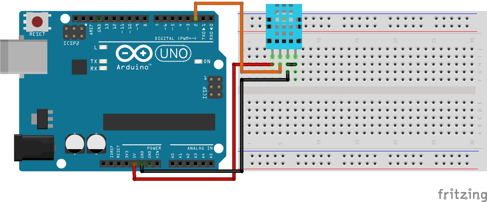
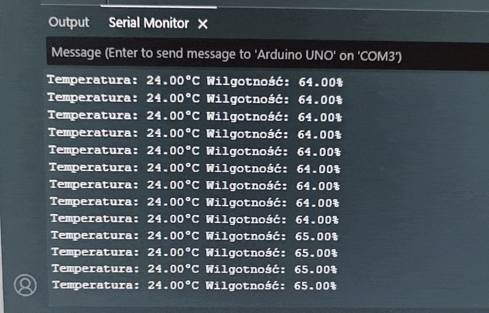

# Lekcja 16: Czujnik temperatury i wilgotności DHT11

Ćwiczenie wykonane podczas pracowni zawodowej. W tej lekcji podłączyłem do Arduino UNO cyfrowy czujnik **DHT11**, który mierzy temperaturę oraz wilgotność powietrza.

Do obsługi czujnika wykorzystałem bibliotekę `DHT.h` używaną w kursie Arduino II na **Forbocie**. Kod bazuje na prostym programie odczytującym temperaturę i wilgotność, a sposób konfiguracji oraz funkcje odczytu zostały dostosowane do tej biblioteki.

Biblioteka:
[markruys/arduino-DHT](https://github.com/markruys/arduino-DHT)

Lekcja Forbot:
[Kurs Arduino II – cyfrowy czujnik wilgotności DHT11](https://forbot.pl/blog/kurs-arduino-ii-cyfrowy-czujnik-wilgotnosci-dht11-id18417)

### Czego się nauczyłem:
* Dowiedziałem się, jak działa cyfrowy czujnik temperatury i wilgotności DHT11.
* Nauczyłem się podłączać DHT11 do Arduino UNO.
* Poznałem bibliotekę `DHT.h` używaną w kursie Forbot.
* Nauczyłem się konfigurować czujnik za pomocą `dht.setup()`.
* Poznałem funkcje `dht.getTemperature()` i `dht.getHumidity()`.
* Dowiedziałem się, do czego służy funkcja `isnan()`.
* Poznałem funkcję `dht.getMinimumSamplingPeriod()`, która podaje minimalny odstęp między pomiarami.
* Przećwiczyłem wyświetlanie wyników w Monitorze portu szeregowego.

### Czym jest DHT11?

DHT11 jest cyfrowym czujnikiem, który mierzy dwie wartości:

* temperaturę powietrza,
* wilgotność względną powietrza.

Czujnik wykonuje pomiar wewnętrznie i przesyła gotowe dane cyfrowo do Arduino za pomocą jednej linii danych.

DHT11 jest prostym i niedrogim czujnikiem. Nie należy do najdokładniejszych ani najszybszych, ale dobrze nadaje się do nauki i prostych projektów.

### Biblioteka `DHT.h`

W projekcie wykorzystałem bibliotekę `DHT.h`, ponieważ właśnie ta biblioteka była używana w materiale z kursu Forbot.

Dołączenie biblioteki do programu:

```C++
#include "DHT.h"
```

Następnie tworzony jest obiekt:

```C++
DHT dht;
```

Obiekt `dht` pozwala korzystać z funkcji przeznaczonych do obsługi czujnika.

### Konfiguracja czujnika

Pin DATA czujnika został podłączony do pinu **D2** Arduino:

```C++
#define DHT11_PIN 2
```

W funkcji `setup()` czujnik jest konfigurowany za pomocą:

```C++
dht.setup(DHT11_PIN);
```

Funkcja informuje bibliotekę, do którego pinu Arduino została podłączona linia danych DHT11.

### Odczyt wilgotności

Wilgotność jest pobierana za pomocą:

```C++
float wilgotnosc = dht.getHumidity();
```

Funkcja `getHumidity()` zwraca wilgotność względną powietrza wyrażoną w procentach.

Przykładowo:

```text
48 %RH
```

oznacza wilgotność względną wynoszącą około 48%.

### Odczyt temperatury

Temperatura jest pobierana za pomocą:

```C++
float temperatura = dht.getTemperature();
```

Funkcja `getTemperature()` zwraca temperaturę w stopniach Celsjusza.

Przykładowo:

```text
22 *C
```

oznacza temperaturę około 22°C.

### Funkcja `isnan()`

Funkcja `isnan()` sprawdza, czy dana wartość jest typu **NaN**, czyli **Not a Number**.

W praktyce oznacza to sprawdzenie, czy odczyt z czujnika zakończył się poprawnie. Jeśli DHT11 nie odpowie albo pojawi się błąd komunikacji, odczyt może nie być prawidłową liczbą.

W programie wykorzystałem:

```C++
if (isnan(wilgotnosc) || isnan(temperatura)) {
  Serial.println("Blad odczytu DHT11");
  return;
}
```

Operator `||` oznacza **LUB**. Warunek zostanie więc wykonany, jeśli błędna będzie temperatura albo wilgotność.

Dzięki temu program nie wyświetla błędnego pomiaru jako prawidłowego wyniku.

### Minimalny czas pomiędzy pomiarami

DHT11 nie powinien być odczytywany bez przerwy z bardzo dużą częstotliwością.

Biblioteka posiada funkcję:

```C++
dht.getMinimumSamplingPeriod()
```

która zwraca minimalny czas wymagany przed wykonaniem kolejnego pomiaru.

W programie wykorzystałem ją razem z `delay()`:

```C++
delay(dht.getMinimumSamplingPeriod());
```

Dzięki temu nie trzeba wpisywać tego czasu ręcznie.

### Wyświetlanie wyników

Komunikacja z komputerem uruchamiana jest za pomocą:

```C++
Serial.begin(9600);
```

Wyniki są następnie wyświetlane w Monitorze portu szeregowego.

Przykładowy wynik:

```text
Temperatura: 22.00 *C   Wilgotnosc: 48.00 %RH
Temperatura: 22.00 *C   Wilgotnosc: 49.00 %RH
```

### Połączenie

W projekcie wykorzystałem czujnik DHT11 podłączony do Arduino UNO.

Najważniejsze połączenia:

```text
VCC  -> 5V
DATA -> D2
GND  -> GND
```

Dokładny sposób połączenia znajduje się na schemacie projektu.

### Pliki w projekcie:

* `16_czujnik_DHT11.ino` - Kod programu
* `schemat_czujnik_DHT11.jpg` - Schemat połączeń
* `prezentacja_dzialania_czujnik_DHT11.gif` - Prezentacja działania

### Schemat połączeń:



### Prezentacja działania:


