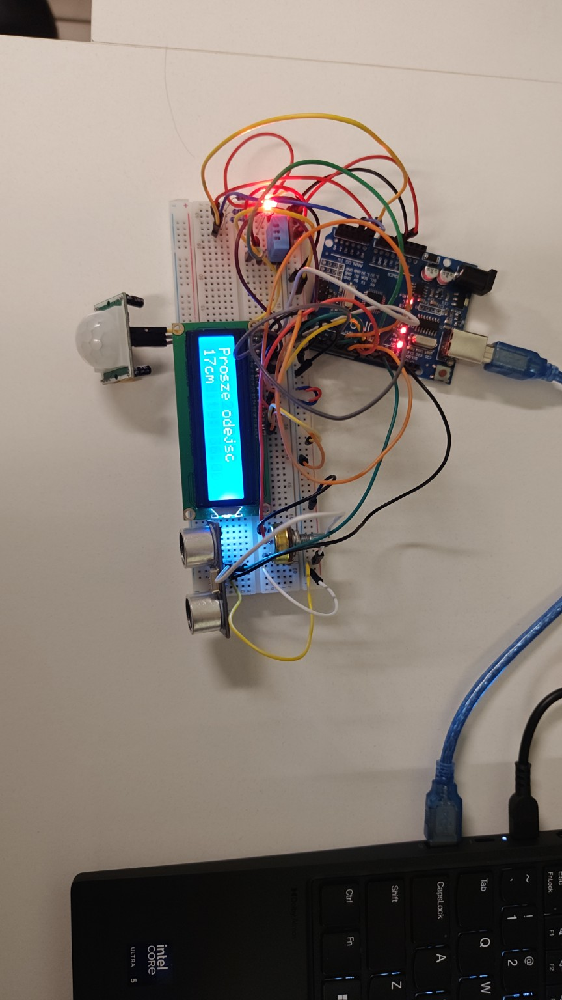
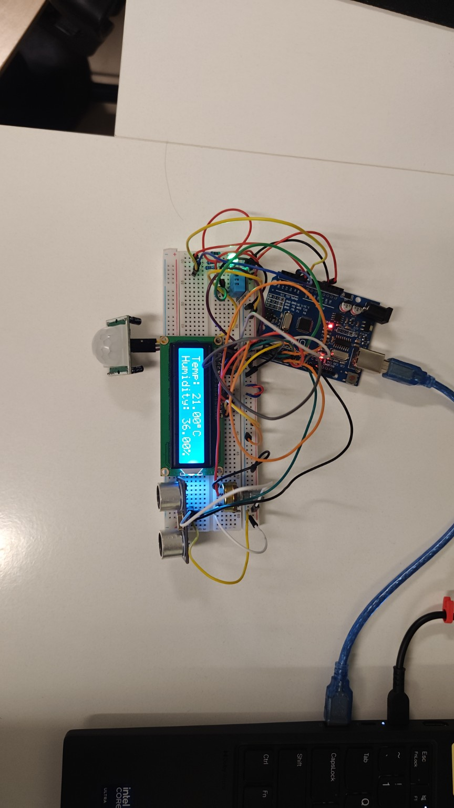

# Lekcja 17: PIR + DHT11 + LCD 16x2 + RGB + HC-SR04

Projekt wykonany podczas pracowni zawodowej **28 października 2026 r.**. W jednym układzie połączyłem kilka wcześniej poznanych elementów: czujnik ruchu PIR, czujnik temperatury i wilgotności DHT11, wyświetlacz LCD 16x2, diodę RGB oraz ultradźwiękowy czujnik odległości HC-SR04.

Celem projektu było połączenie kilku różnych sposobów obsługi wejść i wyjść w jednym programie oraz wykorzystanie **przerwania zewnętrznego** do szybkiego wykrywania zmiany stanu czujnika PIR.

## Elementy użyte w projekcie

* Arduino UNO
* czujnik ruchu PIR
* czujnik temperatury i wilgotności DHT11
* wyświetlacz LCD 16x2 zgodny z HD44780
* dioda RGB ze wspólną anodą
* czujnik odległości HC-SR04
* płytka stykowa
* przewody połączeniowe

## Co robi układ?

Układ wykonuje kilka zadań jednocześnie:

* DHT11 mierzy temperaturę i wilgotność,
* wartości z DHT11 są wyświetlane na LCD 16x2 oraz w Monitorze portu szeregowego,
* PIR wykrywa ruch,
* dioda RGB pokazuje stan czujnika PIR:
  * **zielony** – brak wykrytego ruchu,
  * **czerwony** – wykryto ruch,
* HC-SR04 mierzy odległość,
* jeżeli obiekt znajdzie się bliżej niż około **101 cm**, na LCD pojawia się komunikat:

```text
Prosze odejsc
XXcm
```

## Użyte biblioteki

W projekcie zostały wykorzystane:

```C++
#include <LiquidCrystal.h>
#include <DHT.h>
```

`LiquidCrystal.h` służy do obsługi wyświetlacza LCD 16x2.

Do DHT11 wykorzystałem bibliotekę `DHT.h` używaną wcześniej w materiale z kursu Forbot:

[markruys/arduino-DHT](https://github.com/markruys/arduino-DHT)

## Konfiguracja LCD

Wyświetlacz LCD został podłączony w trybie 4-bitowym:

```C++
LiquidCrystal lcd(9, 3, 4, 5, 6, 7);
```

Pin D2, który był wcześniej używany przy LCD, został przeniesiony na **D9**, aby zwolnić D2 dla czujnika PIR i przerwania zewnętrznego.

## Dioda RGB ze wspólną anodą

Dioda RGB została podłączona do pinów analogowych używanych jako wyjścia:

```C++
#define LED_B A0
#define LED_R A2
#define LED_G A1
```

Dioda ma **wspólną anodę**, dlatego logika sterowania jest odwrócona:

* `LOW` – dany kolor świeci,
* `HIGH` – dany kolor jest wyłączony.

Na początku programu wszystkie kanały są wyłączane:

```C++
analogWrite(LED_G, 255);
analogWrite(LED_R, 255);
analogWrite(LED_B, 255);
```

## Czujnik PIR i przerwanie

Czujnik PIR został podłączony do pinu:

```C++
#define PIR 2
```

Pin D2 w Arduino UNO obsługuje przerwanie zewnętrzne.

Przerwanie jest uruchamiane przez:

```C++
attachInterrupt(digitalPinToInterrupt(PIR), pir, CHANGE);
```

Tryb `CHANGE` powoduje wykonanie funkcji przerwania zarówno wtedy, gdy sygnał zmieni się z `LOW` na `HIGH`, jak i z `HIGH` na `LOW`.

Funkcja obsługująca przerwanie jest bardzo krótka:

```C++
void pir() {
  stanPIR = digitalRead(PIR);
}
```

Nie steruję w niej LCD ani diodami. Funkcja przerwania tylko zapisuje aktualny stan PIR.

Dłuższe operacje są wykonywane później w `loop()`.

## Dlaczego zmienna jest `volatile`?

Stan PIR przechowywany jest w zmiennej:

```C++
volatile byte stanPIR = LOW;
```

Słowo `volatile` informuje kompilator, że wartość tej zmiennej może zmienić się w dowolnym momencie poza normalnym przebiegiem programu – w tym przypadku wewnątrz funkcji przerwania.

Dzięki temu kompilator nie powinien zakładać, że wartość pozostaje niezmienna pomiędzy kolejnymi odczytami.

## Sterowanie diodą RGB

W `loop()` sprawdzany jest zapamiętany stan czujnika PIR:

```C++
if (stanPIR == LOW) {
  digitalWrite(LED_R, HIGH);
  digitalWrite(LED_G, LOW);
} else {
  digitalWrite(LED_R, LOW);
  digitalWrite(LED_G, HIGH);
}
```

Jeżeli nie ma ruchu, świeci kolor zielony.

Po wykryciu ruchu zapala się kolor czerwony.

## DHT11

Czujnik DHT11 został podłączony do:

```C++
#define DHT11 8
```

Konfiguracja:

```C++
DHT dht;

dht.setup(DHT11);
```

Temperatura i wilgotność są odczytywane za pomocą:

```C++
float wilgotnosc = dht.getHumidity();
float temperatura = dht.getTemperature();
```

## Funkcja `isnan()`

Po odczycie DHT11 program sprawdza:

```C++
if (isnan(wilgotnosc) || isnan(temperatura)) {
  Serial.println("Blad odczytu DHT11");
  delay(dht.getMinimumSamplingPeriod());
  return;
}
```

`isnan()` oznacza **is Not a Number**.

Funkcja sprawdza, czy odczyt nie jest prawidłową liczbą. Może się tak zdarzyć np. wtedy, gdy czujnik nie odpowie albo wystąpi błąd komunikacji.

Operator:

```C++
||
```

oznacza logiczne **LUB**, więc obsługa błędu uruchomi się, gdy błędna będzie temperatura **lub** wilgotność.

## Własne funkcje do DHT11

Zamiast umieszczać cały kod wyświetlania bezpośrednio w `loop()`, utworzyłem dwie funkcje:

```C++
serialDHT(temperatura, wilgotnosc);
lcdDHT(temperatura, wilgotnosc);
```

Pierwsza odpowiada za Monitor portu szeregowego, a druga za LCD.

Dzięki temu główna część programu jest czytelniejsza.

## Znak stopnia na LCD

Do wyświetlenia symbolu stopnia wykorzystałem:

```C++
lcd.print((char)223);
```

W typowych wyświetlaczach zgodnych z HD44780 znak o kodzie `223` odpowiada symbolowi stopnia.

## Czujnik HC-SR04

HC-SR04 wykorzystuje dwa piny:

```C++
#define TrigPin 10
#define EchoPin 11
```

Pomiar został zamknięty we własnej funkcji:

```C++
int hcsr04()
```

Najpierw generowany jest impuls wyzwalający:

```C++
digitalWrite(TrigPin, LOW);
delayMicroseconds(2);

digitalWrite(TrigPin, HIGH);
delayMicroseconds(10);

digitalWrite(TrigPin, LOW);
```

Następnie Arduino mierzy długość impulsu na pinie Echo:

```C++
long czas = pulseIn(EchoPin, HIGH);
```

Czas jest przeliczany na odległość:

```C++
int dystans = czas / 58;
```

Funkcja zwraca wynik w centymetrach:

```C++
return dystans;
```

Dzięki temu później mogę wykorzystać ją bezpośrednio w warunku:

```C++
if (hcsr04() < 101)
```

## Komunikat ostrzegawczy

Jeżeli zmierzona odległość jest mniejsza niż 101 cm, normalny ekran temperatury i wilgotności zostaje chwilowo zastąpiony komunikatem:

```C++
lcd.clear();
lcd.setCursor(0, 0);
lcd.print("Prosze odejsc");
```

W drugim wierszu pokazywana jest aktualna odległość.

## Opóźnienie a przerwanie

Na końcu `loop()` znajduje się:

```C++
delay(1000);
```

Opóźnienie spowalnia wykonywanie głównej pętli, ale przerwanie PIR nadal może zostać wywołane podczas `delay()`.

Funkcja przerwania zapisze wtedy nowy stan do `stanPIR`.

Sama dioda zostanie jednak zaktualizowana dopiero przy kolejnym przejściu przez `loop()`, dlatego reakcja koloru może być opóźniona maksymalnie o około sekundę.

## Czego się nauczyłem?

* łączenia kilku czujników i elementów wykonawczych w jednym projekcie,
* wykorzystania przerwania zewnętrznego Arduino UNO,
* używania `attachInterrupt()` i `digitalPinToInterrupt()`,
* znaczenia słowa `volatile`,
* ograniczania kodu wykonywanego bezpośrednio w funkcji przerwania,
* obsługi DHT11 za pomocą biblioteki `DHT.h`,
* sprawdzania błędnych wyników funkcją `isnan()`,
* tworzenia własnych funkcji,
* obsługi LCD 16x2,
* wykorzystania `pulseIn()` i HC-SR04,
* sterowania diodą RGB ze wspólną anodą.

## Pliki w projekcie

* `17_PIR_DHT11_LCD_RGB_HC-SR04.ino` – kod programu,
* `zdjecie_projektu.jpg` – zdjęcie zmontowanego układu,
* `zdjecie_dzialania.jpg` – zdjęcie działającego układu,
* `schemat_projektu.jpg` – schemat połączeń wykonany we Fritzing,
* `prezentacja_dzialania.gif` – opcjonalna prezentacja działania.

## Zdjęcie projektu



## Zdjęcie działania



## Schemat połączeń


## Prezentacja działania


